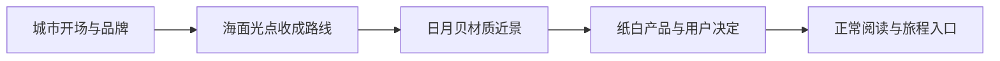

# 问途官网深度改进指南

## 从 3.1 到连续的城市品牌镜头

**编写日期：2026-11-27。** 这是一份供后续设计、素材制作、开发和验收使用的指南，不是新版已经实现的说明。拟议文件、接口、素材数量和性能预算均明确标为下一轮方案。

**源码基线：** `d79fc5ce7e528a54464223e39ddeaf33f83a9ca9`，官网版本 `3.1.0`。再上一轮基础提交为 `262872ae7f6baac08ab7b6efe30765ef5e1e79a3`。本地仓库为 `D:/AAA大三上/软件工程/askway-web/`；下文工程路径均相对于 `source/askway-site/`。

**设计目标：** 访客先记住珠海与问途，再理解「想法如何连成旅程」，最后知道自己可以核对、比较和确认安排。主要投入放在高质量视觉母版、连续分镜和可靠的加载机制。

**推荐主方案：** 高质量预渲染素材 + 原生滚动驱动的短 sticky 舞台 + 局部 Canvas 光点。地图、选点和方案操作继续由现有工作台承担。固定观景短片可以后加；复杂实时三维是经过实机验证后才启用的增强层。

---

## 按问题查找

| 要解决的问题 | 阅读位置 |
| --- | --- |
| 为什么参考站有电影感，问途下一轮该借鉴什么 | [参考与现状](#baseline) |
| 首页到底怎么讲故事、文字和建筑怎么安排 | [首页分镜](#storyboard) |
| 需要摄影、模型、视频还是帧序列 | [素材制作](#assets) |
| 正滚／倒滚怎么稳定，图片怎样避免占满内存 | [进度与缓存](#runtime) |
| 如何暂停、降级、切后台和进入工作台 | [状态与回退](#fallback) |
| 哪些源文件该改，哪些功能要保护 | [工程接入](#engineering) |
| 后续分几批推进，每批何时停止 | [阶段计划](#phases) |
| 怎么验收性能、手机和键盘体验 | [验收矩阵](#verification) |
| 可以直接交给下一次开发任务的提示词 | [启动任务](#handoff) |

<a id="baseline"></a>

## 1. 参考站的实际做法与问途的当前起点

### 1.1 已核实的参考事实

观察来源：[南孚官网](https://www.nanfu.global/)、[公开首页脚本](https://www.nanfu.global/templates/assets/index.d9c9dbee1.js?v=19)、[公开样式](https://www.nanfu.global/templates/assets/index.55.css)。调研日为 2026-11-27，远程资源以后可能更新。

- 首屏使用大幅产品镜头、强烈材质反光与品牌色光环，随后通过画面缩放／裁切和大字章节进入介绍。
- 公开脚本中，主画面的 Canvas 使用 `getContext('2d')`，读取 **120 张帧图**，按滚动值调用 `upData(frameIndex)`；另一组电池 Canvas 为 **150 张帧图**。
- 主画面有桌面与手机的独立帧目录；页面也使用 WebM／MP4 视频。Canvas 帧数量不是实时渲染帧率。
- 首段样式采用约 100vh 的 sticky 画面，外层长度约为 2.3–3 个视口；GSAP 的相关滚动 timeline 使用 `scrub: 0.9`。
- 公开帧加载器用 `Promise.all` 预载一组素材。这是一种可观察的实现选择，不应直接复制成问途的移动加载策略。

这里能够借鉴的是：**视觉母版质量、画面与文字的同步、固定舞台内的构图变化，以及从一个镜头进入下一章节的衔接。** 电池、宇宙背景、红黑配色和营销数字不适合作为问途的素材或产品事实。

本次没有测量南孚的真实手机性能，也没有把加载中的黑色画面当作其最终手机效果。不要把浏览器截图、公开代码或访问现象改写为未经测量的性能结论。

### 1.2 问途 3.1 已经具备什么

| 已有能力 | 对下一轮的价值 | 当前限制 |
| --- | --- | --- |
| 五页静态预渲染、真实导航与独立体验路由 | 正文、分享信息、无 JS 和路由可以继续使用 | 新镜头不能替代静态正文 |
| 首屏实景、两行品牌标题、移动裁图 | 城市与品牌已经有明确主角 | 尚无高质量连续运镜母版 |
| 稳定 Canvas 海面光点 → 三站路线 | 正反向滚动、静态地名和文字避让已有基础 | 光点是二维展示，不产生真实建筑遮挡或镜头环绕 |
| 普通官网共享暂停与系统减少动态效果 | 可以扩展为影片、序列和装饰的共同策略 | 文档隐藏、可见性、渲染所有权仍需要共同判定 |
| 写实风格城市展台、三个机位、独立材质与回退 | 可继续供探索、路线关系和故障回退使用 | 程序化城市与近景仍有简化；机位切换不是连续滚动轨道 |
| 核对、候选比较、采用、撤销及合作草稿 | 产品能力能够真实演示 | 官网动画不能修改这些业务状态 |

当前首页依次使用 `CoastalOpening`、`ImmersiveShowcase`、体验引言和 `JourneyStage`。这些部分各有运动逻辑，下一轮重点是将前两三屏合成一条叙事，而不是继续增加相似段落。

当前源码定位：

| 文件 | 现有职责 |
| --- | --- |
| `src/pages/Home.tsx` | 首页段落及体验、目的地、合作入口 |
| `src/components/CoastalOpening.tsx` | 实景首屏、`#story`、静态路线、粒子懒加载和局部错误边界 |
| `src/components/RouteDiagram.tsx` | 三站 SVG 路径与 HTML 地名 |
| `src/components/SeaRouteParticles.tsx` | Canvas 尺寸、绘制、文字遮罩、离屏／后台／展台暂停 |
| `src/motion/seaRouteMath.ts` | 确定性起点、路线坐标、插值及运行条件 |
| `src/motion/PresentationMotion.tsx` | 会话暂停选择、减少动态效果与控件 |
| `src/hooks/useMotion.ts` | 标题、照片视差、普通入场与一次光扫 |
| `src/components/ImmersiveShowcase.tsx` | 三维展台、海报回退、视角与海面开关 |
| `src/features/experience/scene/cityRuntime.ts` | 当前实时城市、预设机位、灯光、动画及释放 |

### 1.3 性能基线必须如实继承

3.1 的本地记录在 `docs/upgrade/visual-refresh-verification.md` 和 `delivery/visual-refresh/results.json`。

| 指标 | 首页 3.1 | 体验页 3.1 |
| --- | ---: | ---: |
| 三次移动模拟 Performance 中位数 | 97 | 96 |
| LCP 中位数 | 2104.890ms | 2104.690ms |
| CLS | 0 | 0 |
| TBT 中位数 | 37.5ms | 139ms |

存在两次明显慢运行：体验页 LCP 4396.508ms、首页 LCP 7505.872ms，原记录没有排除它们。不能将中位数当作每次加载的保证。

当前桌面／移动最坏模型组合约为 74,268／41,772 三角形、46 次预计绘制，限额为 100,000／50,000 三角形、80 次绘制。新增 1K 材质及 mipmap 约增加 32MiB GPU 内存。

普通页 headless rAF 约 4.2ms 是主机调度观察；SwiftShader 海面约 2.89 次输出／秒是软件 WebGL 结果。二者都不是手机 GPU 耗时或硬件 30／60fps 证明。

<a id="storyboard"></a>

## 2. 首页分镜：一座城市、一段路线、一个明确的决定

### 2.1 先确定静态终稿，再安排运动

先制作四张无动画关键构图：城市开场、三站路线、日月贝近景、纸白产品。每张都应独立成立，能读清标题、看见地标、找到导航和图注。完成这一步才制作完整序列。

首页第一批只建立一个连续主舞台。桌面初始可试 **260svh** 外层、**100svh** 的 sticky 画面；有效滚动距离约为外层高度减画面高度。这里的 2.6 个视口是 260svh，不是字面 2.6vh。实际进度必须根据测得的几何计算，不能写死成滚动 2600px。

手机默认采用相同内容的竖版海报、短光点转场和正常阅读布局；是否开启整段帧序列，由实机验证后的策略决定。

### 2.2 推荐分镜与首轮进度

下列百分比是镜头调试起点，调整必须同时更新素材锚点和章节状态。

| 进度 | 主画面与运动 | HTML 文案／用户理解 | 这一段交付什么 |
| --- | --- | --- | --- |
| 0–18% | 海岸与双贝形成完整开场；镜头幅度小，标题有稳定暗面 | 「让城市探索，／自有方向。」；这里是问途，故事从珠海开始 | 开场海报、无字母版、横／竖构图 |
| 18–50% | 海面反光逐渐抽离、收束成三站连接；摄影与纸白保持空间连续 | 「让心之所向，连成一段旅程。」；三站 HTML 名称与「路线示意」 | 路线关键帧、光点起止与地名锚点 |
| 50–80% | 沿线路或轮廓匹配进入日月贝近景，观察壳板、玻璃、台阶和水线 | 「在城市与海之间，看见珠海。」短暂出现后让建筑承担画面 | 近景母版、可读材质、同机位校验图 |
| 80–100% | 近景缩入预留的纸白媒体区域，运动幅度收束 | 「每一步安排，都由你来决定。」；核对、比较、确认，采用后可撤销一次 | 与末帧匹配的静态卡片、自然体验入口 |

动线：



一个视口内最多安排一项主运动和一项辅助运动。路线、产品卡片、大标题和建筑特写不要同时争夺画面。章节文字使用 HTML，不烧进影片，也不画成 Canvas 字。

### 2.3 源码中的段落取舍

- `CoastalOpening` 可逐步成为新舞台的静态内容入口；保留 `#story`。
- 已讲过的「条件 → 候选 → 确认」只保留一次完整说明。新舞台结束后不要再紧接一套相同的长滚动故事。
- `JourneyStage` 不能在第一次改造时随手删除。它包含已有四阶段交互和键盘回归；若准备收缩或移至产品页，单独记录旧功能迁移、入口和测试变化。
- 三维展台在主舞台之后作为可探索内容存在。固定观看的首屏镜头和自主探索使用不同的交互职责。
- 导航中的「旅程体验」继续与相邻项目同层级；首页视觉中心保持地标和标题。

### 2.4 构图安全区

以下是首轮横／竖素材的构图约束，不是所有设备通用的固定像素。

| 版本 | 推荐安全区 | 要避免的冲突 |
| --- | --- | --- |
| 桌面 | 标题大致在 x=6–43%、y=25–60%；地标主轮廓在右半部；顶端留导航空间 | 白色标题穿过壳体亮面、暖金字与金白反光重合 |
| 手机竖版 | 双贝主轮廓约在 y=20–55%；标题约 y=60–80%，副文案在其下；左右保留约 6% 留白 | 直接裁横版导致地标出框、标题压住建筑、图注贴近系统边缘 |
| 纸白产品末段 | 静态布局先预留媒体卡片与文字区域；转场只覆盖媒体层 | 裁切容器包住文字／按钮，导致键盘焦点不可见 |

首轮延续 3.1 的手机「建筑上方、标题下方」关系。若分镜评审改为另一种构图，应同时改竖版素材、文字位置及锚点，不能只移动 CSS 标题。

缩入卡片优先使用 `transform`、`opacity`、`clip-path`，预留最终布局；持续修改正文区域的 width／height 会使滚动位置和重排成本难以控制。编码后首末帧与交接海报应核对轮廓、裁切、曝光和色域，首轮可将轮廓误差不超过 2 CSS px 作为交接调试目标。

<a id="assets"></a>

## 3. 素材制作：先有能够独立成立的画面

### 3.1 两条可执行素材路线

**推荐：离线三维母版。** 以合法参考资料校正日月贝主体和近岸，再离线输出高精度镜头。程序化城市可继续用于远景参考、工作台和故障回退；首屏无需背负整个高精度城市的实时几何。

**可用替代：有授权的实景运镜。** 若已有稳定的海岸／日月贝摄影短片，可以先以实景镜头建立电影感，再将路线和产品说明作为独立 HTML／Canvas 图层。光线与构图要覆盖标题安全区。

没有新素材时，P1 可用现有摄影和三张关键静帧验证滚动关系，并明确称为「转场原型」。画质定稿需要母版工作，不能把摄影平移或现有低模放大当作最终近景质量。

### 3.2 日月贝离线母版制作 brief

1. **灰模与尺度。** 先核对一大一小双贝关系、间距、壳体厚度、玻璃曲率、基座与实际岸线。栏杆、入口、台阶和铺装使用同一尺度参照。绝对尺度未核实就标相对参考，不表述成测绘模型。
2. **近景材料。** 壳板、玻璃、金属、铺装、护岸湿石分别承担反射与粗糙度。现有 1K 图可作底层，但是否升级细节以固定输出机位判断；纹理不能为了文件大而升级。
3. **环境与太阳。** 确定一套主线光照。日景全景和黄昏近景另存校验机位；转场中改变时间应有连续设计。HDR 方位、高度、曝光和色调分别验证，不能只靠旋转宣称现场光照准确。
4. **近岸与背景。** 精修近镜头经过的护岸、水线、步道及植物尺度。背景楼群用于衬托地标，避免重复立面、大片空岛盘和过大的尺度物主导画面。
5. **相机与文字空间。** 相机位置、目标、焦距、速度和可见标签锚点一起定稿。手机重新构图并出帧，不能只从桌面序列中心裁切。
6. **编码后复核。** 实际 WebP／视频输出也要对照，检查色域、亮部层次、阴影、板缝闪烁、反射断裂及首末帧接缝。

### 3.3 最小交付包

| 交付物 | 内容与检查 |
| --- | --- |
| 可编辑母版 | 场景、相机、灯光、材质、工具版本及引用文件；保留原始授权资料 |
| 四张关键帧 | 城市／路线／近景／产品末段，各有桌面和手机构图；关闭动画仍可验收 |
| 无字序列 | 编号连续、尺寸一致，首末帧与交接海报同源；文字与按钮由网页绘制 |
| 标签锚点 | 三站、地标边缘、文字安全区的归一化位置与适用阶段 |
| 影片（可选） | 固定观景镜头先试 6–8 秒、静音；同机位 poster，手机另做适配 |
| 资产清单 | 内容来源、尺寸、帧数、字节数、SHA-256、作者、许可、母版版本和处理方法 |

首轮建议的素材参数：

| 用途 | 桌面 | 手机 |
| --- | --- | --- |
| 滚动序列母版 | 先试 1280×720、96 个采样帧 | 默认先海报＋轻 Canvas；可选 720×1280、72 帧试导出，实机通过后启用 |
| 普通观看短片 | 1080p 可作为试导出上限 | 先试 720p，按实际传输和解码判断 |
| 主海报 | 一张与首帧一致的 WebP／AVIF，兼容格式保留 | 单独竖版，优先清楚的轮廓与正文安全区 |

96 帧是可索引素材数，不是 96fps，也不自动规定网页播放时长。视频帧率、素材采样密度、滚动更新频率和实际渲染帧率必须分开记录。

### 3.4 准确标注与来源

| 素材 | 页面标注 |
| --- | --- |
| 现场摄影或拍摄运镜 | 实景摄影 |
| 纯三维输出 | 三维渲染 · 场景示意 |
| 摄影与 CG 合成 | 实景摄影＋三维合成 |
| 连接示例地点的图形 | 路线示意 |

逐项保存作者、原始地址、授权／许可依据、制作人员、裁切／调色／合成方法、母版版本和导出哈希。HDR 只说明光照素材来源，不标成珠海实景。

新素材替换当前 `hero.webp` 时，`CoastalOpening` 中硬写的「实景摄影」和图片 alt 必须一起改。南孚素材用于研究其表达与实现，不直接进入问途的 `public/`。

<a id="runtime"></a>

## 4. 连续进度与资源缓存

### 4.1 统一进度，分别承担职责

主舞台只产生一个归一化进度 `p`。帧索引、局部光点、裁切和章节强调都从 `p` 派生；时间型水面微动另用可暂停的 active time。不要将每帧进度写进 App／Routes 的 React state，使工作台跟着重绘。

```text
p = clamp((scrollTop - stageStart) / max(stageHeight - stickyHeight, 1), 0, 1)
frameIndex = round(p × (frameCount - 1))
```

这里 `clamp(x, 0, 1)` 表示把有限数夹在0与1之间；非有限输入另行回到0。公式是进度约束，不是可直接粘贴的完整运行时实现。

实施要求：

- 非有限进度回到安全值 0；帧数量必须是正整数；越界滚动夹在首末帧。
- 正反方向由进度差派生，用于队列优先级，不靠累加 frameIndex 推进。
- 路由／素材版本／变体改变时重新确认几何；普通反滚不要重置整个舞台。
- ResizeObserver、字体就绪和图像尺寸变化触发本段测量，滚动事件合并到一次 rAF；避免绘制循环每次读取整页布局。
- 沿用 GSAP 时只创建本段 context／trigger，离开时只清理它。不要调用 `ScrollTrigger.killAll()`。
- `scrub: 0.9` 可作参考试调值，快速倒滚时须验证滞后；相同逻辑进度必须能够回到相同构图。
- Canvas／视频／裁切层 `pointer-events: none`；导航、正文选择、滚轮和触摸使用原生行为。

### 4.2 首屏加载顺序

1. 静态 HTML、标题、导航和主海报先显示。
2. 主海报完成解码并绘出后，按可见性与空闲机会加载展示模块；海报在模块失败时继续存在。
3. 先准备当前关键帧，再少量预取前后邻帧；序列全包不进入首屏 preload。
4. 当前帧缺失时保留 last-good-frame，或显示当前章节的关键海报；不先清空 Canvas 等网络。
5. 固定短片接近视口且策略允许才请求，`play()` 被拒绝时保留 poster 和正常阅读。
6. 远离舞台停止连续绘制与非必要预取；进入体验路由释放官网展示层。

海报与序列第 0 帧尽量使用同一资源或同一次导出，避免重复下载、重复解码。后续关键海报必须能在跳到某章、快速倒滚或缺帧时提供正确语境。

### 4.3 解码内存预算

压缩文件大小与运行内存是两项指标。粗略下限为 `width × height × 4`；Canvas 后备缓冲、解码临时对象、视频缓冲、纹理和浏览器开销另计。

| 计算 | RGBA 下限 |
| --- | ---: |
| 1280×720 一帧 | 3.515625MiB |
| 同尺寸 96 帧全解码 | 337.5MiB |
| 桌面缓存 12 帧 | 42.1875MiB |
| 720×1280 一帧 | 3.515625MiB |
| 手机缓存 8 帧 | 28.125MiB |

首轮建议：**桌面 decoded frame cache 上限 48MiB，手机上限 32MiB**。它们是缓存预算，不是整页 GPU 内存承诺。实际预算按解码尺寸计费，不能只统计 WebP 文件字节或 JS heap。

缓存必须有这些规则：

- 按字节计费的 LRU；当前帧与 last-good-frame 计入同一预算。
- 下载和解码分别限流。初始并发可试桌面 2、手机 1，依实机证据调整。
- 按方向预取邻帧；方向改变只调整待处理队列，远离目标的任务可取消。
- 原子交接当前帧：有效新帧准备好再替换；仍在绘制的帧不得被淘汰关闭。
- fetch 可以 AbortController 取消；已启动解码可能不能取消，迟到结果需检查 epoch，再缓存或立即关闭。
- 淘汰、素材变体切换、路由退出和整体销毁时，对拥有的 ImageBitmap 调用 `close()`，各释放一次。
- 重试仅用于当前／关键帧，初始最多 2 次退避；持续失败转海报，不在每次 rAF 重试。
- 第一张海报、背景序列和后续三维纹理的内存不能各自无限保留；交界处要检查总峰值。

### 4.4 局部光点的范围

继续使用当前确定性起点与三站终点思路，先增强深度分布、光点大小和少量拖尾。首轮可维持约 280／100 点，再根据画面与帧时间决定；数量不作为电影感验收指标。

二维光点能完成海面闪光和路线聚合。真实穿行建筑、几何遮挡和体积光需要同一三维场景的深度信息，或由离线母版烘焙。P1 将光点约束在海面与路线带，并继续避让文字和地标轮廓。

桌面 DPR 建议上限 1.5，手机 1；连续微动可以按约 60／30Hz 上限调度。路线完全静止后只响应滚动、尺寸与恢复事件，不持续清屏重绘。高刷新率主机的 rAF 不意味着每次回调都需要绘制。

<a id="fallback"></a>

## 5. 暂停、回退与切页的状态契约

### 5.1 模式表

| 条件 | 展示模式 | 绘制／资源行为 |
| --- | --- | --- |
| 桌面策略允许，舞台可见，资源正常 | 完整序列＋局部光点 | 按当前进度、限流预取 |
| 手机未通过序列实机验收 | 竖版海报＋轻量光点／路线 | 不自动下载完整序列或开启实时三维 |
| 用户暂停 | 可读的静态章节／当前安全画面 | 停止自动影片、连续光点与帧推进，正常滚动保留 |
| 减少动态效果／省流 | 完整关键海报、静态路线与正文 | 不自动影片、不请求重序列／三维 |
| 文档隐藏／舞台离屏 | 保留恢复位置 | 停止连续绘制与非必要预取，不补播隐藏期间时间 |
| 帧／chunk 加载失败 | last-good-frame 或章节海报 | 有限重试、局部错误边界，页面不被卸载 |
| 自动播放被拒绝 | poster 与手动观看入口 | 不反复调用 play 强行开启 |
| 进入 `/experience/` | 工作台自身的地图与场景 | 官网展示模块退出绘制、监听与素材加载；暂停选择保留 |

暂停或回退不要临时收缩舞台高度。静态章节和媒体位置预先存在于同一阅读结构，切模式只改变视觉层；恢复时读取当前滚动进度，不从开头重播。系统减少动态效果也不能留下两屏空白等待动画。

### 5.2 统一允许条件与所有权

沿用 `PresentationMotionProvider` 作为用户选择来源，不再创建第二套 localStorage／sessionStorage 暂停偏好。

```text
canDraw = ready AND NOT paused AND NOT reducedMotion
          AND NOT saveData AND documentVisible AND stageVisible
          AND ownsPresentationSurface
```

现有 `motionAllowed` 尚不包含所有这些条件，新舞台不能只读一个布尔值就持续绘制。文档隐藏、可见性、资源模式和 owner 应共同判定。

整个官网同一时刻只允许一套连续重型展示调度。主舞台的序列与局部光点由同一控制器调度；实时展台开始运行时，主舞台让出展示 owner。渲染互斥不能关闭地图选点或业务操作。

停止 rAF 不等于释放内存。未运行的位图缓存、视频缓冲和 WebGL 纹理仍可能保留；交界峰值超过预算时，缩小闲置缓存或卸载并 dispose 不再需要的展示实例。`renderer.info.memory` 是资源数量信息，不是精确 GPU 字节数；图片字节、解码内存、JS heap 和 GPU 估算要分开记录。

全局暂停约束所有自动影片／光点／海面效果；局部海面按钮与全局允许条件取交集，不隐式取消全局暂停。手动地图操作、模型旋转和表单编辑仍响应用户。

### 5.3 关键边界

- 手机旋转、桌面缩到手机、字体就绪：保留逻辑进度，重算布局／裁切／标签遮罩，旧变体异步结果不得覆盖新变体。
- 直接打开 `#story` 或 `#download`：先滚到正确锚点并可见聚焦；远离首屏时不因模块 import 自动播放开场。
- 暂停后进入另一页再返回：仍然暂停；离屏后恢复不改变访客选择。
- 导航菜单打开：保留焦点圈、Esc 关闭与归还焦点、滚动锁释放；新增影片控件不能逃出菜单焦点范围。
- 全局不拦截空格／方向键来播放镜头；只有聚焦的明确控件响应其键盘操作。
- 静态标签、图注和按钮不进入媒体裁切容器，避免可聚焦元素被裁掉。
- 保留 `#story` 给路线章节；可以新增原生「跳过城市镜头」链接到 `#product-intro`。跳转先定位并可见聚焦 HTML 章节，运行时跟随当前位置，不锁回开场。

<a id="engineering"></a>

## 6. 工程接入与拟议接口

### 6.1 建议新建独立展示功能目录

以下路径是拟议方案，当前基线尚未实现。第一阶段只创建实际需要的文件，不为所有可选效果预建空壳。

| 拟议文件 | 责任 |
| --- | --- |
| `src/features/cinematic/types.ts` | 资产、变体、进度、运行策略和缓存统计类型 |
| `src/features/cinematic/storyConfig.ts` | 四段区间、文案、关键海报与安全区 |
| `src/features/cinematic/progress.ts` | 可逆进度、阶段与帧索引纯函数 |
| `src/features/cinematic/useStoryProgress.ts` | 原生滚动／resize 的本段测量与调度 |
| `src/features/cinematic/StoryStage.tsx` | 静态章节、短 sticky 舞台、文字与入口 |
| `src/features/cinematic/SequencePlayer.tsx` | Canvas 媒体绘制与 last-good-frame 交接 |
| `src/features/cinematic/FrameLoader.ts` | fetch、解码、并发、重试和 epoch |
| `src/features/cinematic/DecodedFrameCache.ts` | 字节 LRU、pin、淘汰、统计与释放 |
| `src/features/cinematic/PresentationOwner.ts` | 展示 surface 注册与连续绘制互斥 |
| `src/features/cinematic/VideoPoster.tsx` | 后续固定短片、poster 和 autoplay 回退 |
| `src/features/cinematic/cinematic.css` | 媒体裁切与布局，限制于展示功能 |

`FrameLoader`、`DecodedFrameCache` 是独立资源职责；`StoryStage` 不负责规划候选，`SequencePlayer` 不负责导航焦点。原有城市 runtime 继续位于 `features/experience/scene/`。

### 6.2 拟议契约示例

下面用于约束分工，不表示代码已经存在。落地前应在本阶段执行计划里给出完整类型和测试。

```ts
type StoryPhase = 'city' | 'route' | 'theatre' | 'product';
type StoryVariant = 'desktop' | 'mobile';
type AssetKind = 'photo' | 'render' | 'composite' | 'diagram';

interface SequenceSpec {
  id: string;
  version: string;
  variant: StoryVariant;
  kind: AssetKind;
  width: number;
  height: number;
  frameCount: number;
  poster: string;
  framePathPattern: string;
  decodedCacheBudgetBytes: number;
}

interface StoryProgress {
  value: number;
  direction: -1 | 0 | 1;
  phase: StoryPhase;
  targetFrame: number;
}

interface PresentationPolicy {
  paused: boolean;
  reducedMotion: boolean;
  saveData: boolean;
  documentVisible: boolean;
  stageVisible: boolean;
  ownsSurface: boolean;
}

interface SequenceRuntime {
  setTarget(progress: StoryProgress): void;
  setPolicy(policy: PresentationPolicy): void;
  resize(width: number, height: number, dpr: number): void;
  getStats(): {
    decodedFrames: number;
    decodedBytes: number;
    pendingFetches: number;
    pendingDecodes: number;
    displayedFrame: number | null;
  };
  dispose(): void;
}
```

帧路径、poster 和视频地址通过现有 `asset()` 构造，例如拟议的 `asset('cinematic/city-route/v1/desktop/00000.webp')`。路径只是方案，不能在素材未交付时创建声称已可用的资源地址。

拟议 manifest 至少包含：内容来源、版本、变体、实际尺寸、帧总数、关键帧、编号规则、每帧字节／哈希、标签锚点和安全区。不要在清单里混入业务候选状态。

### 6.3 修改既有工程的位置

| 既有位置 | 下一轮修改边界 |
| --- | --- |
| `src/pages/Home.tsx`、`src/components/CoastalOpening.tsx` | 接入新舞台，先保留已有静态章节与锚点，再按验收去重 |
| `src/components/RouteDiagram.tsx`、`src/motion/seaRouteMath.ts` | 保留三站名称与坐标契约；与新镜头锚点对齐，不制造另一份示例地名 |
| `src/components/SeaRouteParticles.tsx` | 消费统一进度／策略，保留文字避让与停止绘制，不另建全站 RAF |
| `src/motion/PresentationMotion.tsx` | 扩展共同策略或隔离小展示消费者，偏好继续跨页保持 |
| `src/hooks/useMotion.ts` | 主舞台排除重复控制照片；普通页面原入场与一次光扫保留 |
| `src/components/ImmersiveShowcase.tsx` | 接入展示 owner 和全局暂停，保留局部选择与海报回退 |
| `src/site.ts`、`src/App.tsx`、`scripts/build.mjs` | 更新实际主图／分享图／预加载，保持 SSR、basename 和 canonical |
| `scripts/serve.mjs` | 若采用视频，补 MIME 和 Range；不用视频时无需为想象中的资源修改 |
| `public/asset-credits.json`、`public/assets/realism/sources.json` | 继承旧来源，新资产另建清单，避免覆盖历史证据 |

主海报改成响应式 `<picture>` 后，preload 的 `imagesrcset`／`imagesizes` 与实际 source 必须一致，不能让手机同时优先请求桌面和手机两张图。OG 分享图使用稳定静态资源，不使用视频或一个尚未下载的帧。

### 6.4 视频的额外条件

如果后续增加固定短片：

- 使用 `muted`、`playsInline`、poster，接近视口才加载；全局暂停适用于影片。
- 当前预览类型表需要补 `.mp4 → video/mp4`、`.webm → video/webm`。
- 需要 seek 的媒体要验证真实部署端 Range 支持：正常范围返回 206、正确 Content-Range／Content-Length／Accept-Ranges，越界返回 416。
- 验证拒绝自动播放、资源失败、省流、减少动态效果和手动暂停；都能继续阅读。
- 精确正反滚镜头优先序列。`video.currentTime` seek 受关键帧间距和异步解码影响，不以桌面一次成功代替手机验证。

### 6.5 可选实时相机轨道

当前 `cityRuntime` 具备 `setPreset`、`setLighting`、`setAnimation`、`dispose` 等方法，预设机位是直接设置目标、半径和方位。连续滚动相机不是现成接口。

只有需要自主旋转地标、粒子与建筑发生真实遮挡等收益时，再单独规划 `setStoryProgress` 或一个 cinematic adapter。它应插值位置、目标与 FOV，保持 story／manual／preset 只有一个相机控制者；不能与原聚焦过渡和用户拖动同时争夺镜头。

工作台仍然读取自己的选点与方案。展示相机变化不能调用 adopt、undo 或自动替换 selectedPlaceId。

## 7. 各页继续承担不同任务

| 页面 | 画面与节奏 | 功能保护 |
| --- | --- | --- |
| 首页 | 主舞台承担最大运动，之后回到正常阅读与探索 | 导航、向下浏览、后退、旧故事功能迁移有记录 |
| 产品 | 纸白完整路线，少量流光，再进入真实演示／下载 | `#demo/#download`、编辑后结果失效、只显示实际结果地点 |
| 关于 | 建筑局部与安静正文，照片内一次光扫或后续固定短片 | 图注、阅读顺序、`#reference` 与依据边界 |
| 合作 | 目录式方向，边缘光扫结束后停止 | `#contact`、方向预选、错误关联、首错焦点、草稿失效、复制回退 |
| 体验 | 二维／三维与版本比较承担交互 | 官网装饰退出；核对、候选、采用、放弃、撤销、移动面板和冲突焦点 |

保留 `/`、`/product/`、`/about/`、`/cooperation/`、`/experience/` 和 `#main/#story/#journey/#demo/#download/#contact/#reference`。调整旧入口时给出迁移方案，不静默删除。

不添加未经验证的用户量、城市数量、规划成功率或合作品牌。参考点、规则估算与现场入口／开放信息的未知继续清楚区分；电影画面不扩大实时交通或现场导航能力承诺。

<a id="phases"></a>

## 8. 分阶段推进，每批都能单独验收和回退

### P0 · 基线与关键构图

**交付：** 当前设备记录和资源清单；四张关键帧的横／竖构图；母版来源与权利依据；本阶段执行计划。

- [ ] 核对实际源码 HEAD、工作区与已有未提交改动，记录本轮起点。
- [ ] 同条件保存 1440、390、320 及实际 200% 缩放的基线，注明哪个是等效 CSS 模拟。
- [ ] 做城市、路线、近景、产品四个无动画稿，不先输出整套数百帧。
- [ ] 固定日景全景与黄昏近景，检查尺度、光线与材料可读性。
- [ ] 确认主海报、来源标签、首末交接和素材预算。

**推进条件：** 无动画也成立；建筑、标题、图注和入口互不遮挡；素材来源明确。资产缺失时仅进入清楚标注的转场原型。

### P1 · 一个连续主舞台原型

**范围：** 只完成首页主舞台，不同时改所有页面或提高整座实时城市精度。

- [ ] 原生滚动＋一个短 sticky 舞台，统一 `p` 与章节。
- [ ] 用关键帧／现有摄影实现城市 → 路线 → 近景 → 纸白交接。
- [ ] 标题、三站与入口是 HTML，静态阅读和局部错误边界先可用。
- [ ] 对进度夹限、正反向和边界写有意义的测试；纯排版使用截图／视口检查。
- [ ] 记录快速正滚、倒滚、急停和直达锚点。

**推进条件：** 相同进度回到相同构图，文字不漂移，没有滚动接管、重复开场、空白闪帧或焦点裁切。

### P2 · 正式序列、缓存与回退

**交付：** manifest、限流加载器、字节缓存、策略／owner、资源故障证据。

- [ ] 当前海报先出现，当前帧优先，邻帧预取有界。
- [ ] 迟到解码检查 epoch，Bitmap 淘汰和销毁各释放一次。
- [ ] 用户暂停、后台、离屏、省流和减少动态效果能停止实际工作。
- [ ] 手机默认轻量；可选序列先在真实设备测解码与峰值内存。
- [ ] 缺帧、断网、404、chunk 失败和拒绝播放仍可阅读。

**推进条件：** 缓存不超约定字节预算，反滚稳定，停止后无连续绘制／无无限重试，路由退出无旧回调落画面。

### P3 · 页面节奏和旧内容迁移

- [ ] 产品、关于、合作按页面任务使用运动，资料／表单区安静。
- [ ] 旧 `JourneyStage` 等功能收缩或迁移经过单独回归。
- [ ] 各路由刷新、锚点、菜单、键盘和浏览器后退可用。
- [ ] 工作台与下载／合作草稿逻辑不因展示层改变。

**推进条件：** 去掉页名仍能从构图辨认用途；现有主要流程闭环通过。

### P4 · 可选影片与实时增强

- [ ] 固定镜头短片有同机位 poster 和 autoplay／Range 验收。
- [ ] 需要实时轨道才扩展相机接口；一次只升级镜头经过的地标。
- [ ] 固定机位证明新增材质／几何改善，预算与资源释放通过。
- [ ] 实机收益不足或超过预算时保留前阶段的海报／序列方案。

**推进条件：** 有可复查的画面或交互收益，移动与回退仍满足预算；未测真机的重型模式不成为手机默认。

### P5 · 收尾与发布前检查

- [ ] 保存最终桌面／手机／极限尺寸、正倒滚与故障证据。
- [ ] 同条件改前改后各冷启动三次，保留所有单轮与中位数。
- [ ] 独立记录普通转场和实时展台各 10 秒，区分真实输入、合成滚动、硬件与软件 WebGL。
- [ ] 独立审查需求、代码、来源、SSR、回退和权限边界。
- [ ] 构建并核对静态根目录；本地结果可审查后，再依据发布授权处理外部站点。

**推进条件：** 没有未说明的关键缺陷，目标设备和未覆盖项写清，产物对应已验收源码。

<a id="verification"></a>

## 9. 验收矩阵与首轮建议预算

以下是下一轮的建议目标，不是已经实现或已经测得的指标。若变更预算，记录原因、目标设备和成本，不能直接删掉慢运行。

| 项目 | 首轮建议／检查方法 |
| --- | --- |
| 冷启动 | 同网络／CPU／视口各三次；移动 LCP 中位数 ≤2.5s、CLS ≤0.1；与本次新采集基线比较 |
| 主线程 | TBT 作为实验室指标参考，先争取 ≤200ms；明显回退检查启动、解码和重绘，不以它替代真实 INP |
| 普通主舞台 | 实际目标设备记录 10 秒，60Hz 以16.7ms帧预算调优；记录 p95、长帧、输入链和缺帧停留 |
| 海面／三维 | 单独记录目标帧调度与真实输出、draw calls、三角形、DPR；软件结果不推断硬件 |
| 解码缓存 | 桌面48MiB、手机32MiB起步，按实际位图尺寸统计，临时解码与Canvas缓冲另计 |
| 显示密度 | 展示层DPR桌面≤1.5、手机≤1起步；依据截图与实机调整 |
| 初始资源 | 关键路径只有主海报；序列／视频按需加载，报告新增与总传输量 |
| 当前实时城市 | 保留桌面100k／移动50k三角形、80预计draw calls上限；改变需另有实测依据 |
| 布局 | 1440、390、320px；实际200%缩放、横屏与软键盘；图注、控件、地标不裁切 |
| 无障碍 | 正文／输入16px，图注与次级标签至少12px，触控44px；对比、焦点、顺序、暂停与系统减少动态 |

### 9.1 必测故障和交界

| 场景 | 期望结果 |
| --- | --- |
| 关闭 JS | 海报、标题、三站、正文与导航可读，页面不留隐藏文案 |
| 关键帧404／解码失败 | 当前安全画面保留，有限重试后海报回退 |
| 动态chunk失败 | 仅装饰层失败，主页面仍在 |
| 暂停 → 另一页 → 返回 | 保持暂停，不从头自动播放 |
| 系统减少动态效果实时切换 | 实际绘制停止，正文／静态路线完整，页面高度不跳 |
| 切后台再回来 | 不补播错过时间，读取当前滚动目标与原暂停选择 |
| 快速反滚／跨章跳转 | 最新目标优先，无旧variant／epoch覆盖 |
| 竖横屏及宽度跨断点 | 裁切、帧变体、文字安全区同时更新 |
| 主舞台与实时展台同屏 | 连续重型调度互斥，文字和操作仍可用 |
| 关闭WebGL／context lost | 静帧、二维与原方案操作保留 |
| 菜单／表单／工作台 | Esc、焦点圈、首错聚焦、复制回退、采用／撤销和后退可用 |

### 9.2 验收证据最低内容

每批保留：源码 SHA、资产 manifest 版本、主图／构建哈希、设备型号／GPU／浏览器版本／视口／DPR、网络与CPU设置、资源初次／完整下载量、缓存峰值、逐轮性能值、关键操作结果、同机位截图和正倒滚记录。

真实手机、桌面模拟、合成 `scrollTo`、真实触摸／滚轮、SwiftShader 和硬件GPU分别标注。缺真机时可以完成可读原型和实验室回归，但不能签署“手机流畅／硬件30fps已验证”。

### 9.3 现有工程验证入口

运行目录是实际源码 `source/askway-site/`。先在每个PowerShell终端设置本进程路径：

```powershell
$siteRoot = (Get-Location).Path
$env:TEMP = Join-Path $siteRoot '.agent_tmp'
$env:TMP = $env:TEMP
$env:APPDATA = Join-Path $siteRoot '.agent_tmp/appdata'
$env:LOCALAPPDATA = Join-Path $siteRoot '.agent_tmp/localappdata'
$env:XDG_CONFIG_HOME = Join-Path $siteRoot '.agent_cache/config'
$env:XDG_CACHE_HOME = Join-Path $siteRoot '.agent_cache'
$env:npm_config_cache = Join-Path $siteRoot '.agent_cache/npm'
New-Item -ItemType Directory -Force -Path $env:TEMP,$env:APPDATA,$env:LOCALAPPDATA,$env:XDG_CONFIG_HOME,$env:npm_config_cache | Out-Null
```

依赖已就绪时：

```powershell
npm run typecheck
npm test
npm run test:experience
npm run build
npm run preview
```

第二终端通过 `TEST_URL` 指向实际预览（默认4173；若使用4191则设置4191）：

```powershell
$env:TEST_URL = 'http://127.0.0.1:4173'
$env:VISUAL_TEST_URL = $env:TEST_URL
npm run test:static
npm run test:browser
npm run test:regressions
npm run test:download
npm run test:workbench
npm run test:scene
npm run test:visual
node tests/experience/realism-browser.mjs
node tests/experience/quality.mjs --axe-only
```

新序列运行时要另加覆盖夹限／反向／缓存字节／epoch／关闭位图／模式切换的测试。改造3.1后，`test:visual` 与原滚动故事测试可能依赖旧DOM；迁移时按用户行为重写定位，不能只是删除失败断言。

性能测量在其他浏览器任务结束后单独执行：

```powershell
$env:QUALITY_OUTDIR = 'delivery/cinematic-p1/performance/run-1'
node tests/experience/quality.mjs --lighthouse-only
```

再以独立目录运行run-2、run-3；每轮保持同一构建与条件。动画录屏单独进行，录制开销不计入帧性能。

旧 `render-city-illustrations.mjs` 会导入 Vite 的 `/src/`，供当前程序城市出图；它不是离线电影母版工具。若复用它，用实际dev地址设置 `RENDER_URL`，继续要求有效proposal、资源ready且fallback=0。

发布产物：完成构建与回归后，`npm run sync:publication` 同步本仓库静态根目录。额外校验子路径部署、资源 Content-Type／Range 和预加载；外部推送、部署按实际授权执行。

<a id="handoff"></a>

## 10. 可直接复用的启动任务

下面文本用于后续用户明确要求开始实施时。一次只推进指定阶段，不能把整份指南同时塞进一轮未分解的改造。

> 请以问途3.1实际源码为起点，先核对HEAD与已有改动，阅读《问途官网深度改进指南》和3.1验收记录。按照P0与P1完成一个可审查的首页主舞台原型：城市开场、光点成三站路线、日月贝近景、纸白产品交接。优先静态关键构图与原生滚动，正文、地名、导航和路由始终可读；没有新母版时明确标为转场原型。只为本阶段创建必要文件，保持工作台、合作草稿、下载状态和现有业务状态。所有写入、缓存和临时目录限定在当前允许工作区；子智能体仅gpt-6.1-sol。按本阶段范围执行类型、功能、回退、布局与性能检查，提供真实证据和未覆盖项。未经额外授权，不安装会外写的工具、推送或发布外部站点。

后续任务分别指定：

- **P2：** 在已验收主舞台上接正式序列、缓存、运行策略和回退；先验证内存与快速反滚。
- **P3：** 保持首页主线，完成产品／关于／合作的节奏与旧内容迁移，保护所有关键操作。
- **P4：** 只对有明确画面／交互收益的影片或实时镜头增强，提供同条件对照与实机数据。
- **P5：** 汇总同构建验收、独立审查、发布目录核验和可恢复交付。

## 11. 工作区与协作边界

- 所有创建、修改、删除、下载、缓存和临时文件遵循用户当前工作区规则；本地路径根据任务实际允许根目录解析。
- 工作区外默认只读。尤其不写 Windows、Program Files、ProgramData、用户 AppData、系统TEMP／TMP、注册表、系统环境、全局配置、服务或计划任务。
- 优先使用已有依赖与工具；必要时先只读检测。不能假定Blender、编码器、浏览器或模型包已安装。
- 若命令仍可能外写，执行前说明命令、路径、原因、大小／耗时和清理方式，并取得具体许可；进程级环境设置不等于允许任意工具外写。
- 临时放 `.agent_tmp/`，缓存放 `.agent_cache/`。递归删除／移动前核对实际绝对目标、归属和链接；自动审批拒绝后不换工具绕过，保留目录并报告。
- 在原授权范围内的普通可逆实现继续推进；不要为每个样式变量或测试重复要求确认。新增素材方向未定时先提供可审查关键构图，外部发布或额外外写权限另行处理。
- 子智能体仅 `gpt-6.1-sol`；让资产、运行时、页面／无障碍分别有明确负责范围，避免多人修改同一入口。独立审查检查实际diff与证据，不以实现者自报通过为结论。

## 12. 这一轮何时算完成

首页前两三屏构图连续、素材质量过关，手机默认仍轻且可读；所有暂停／回退是真正停止工作，关键路由与业务闭环保持；类型、预算和目标设备结果可复查；署名、源码、静态产物与验收版本对应。

最终交付至少包含：维护源码、关键构图、素材清单、可编辑母版的保存位置、横／竖输出、正倒滚记录、每批验证报告、已覆盖与未覆盖设备，以及回退到上一可用阶段的方法。

以这个结果判断是否继续增加效果。后续新增的每一层镜头、光线或材质，都应能说明它改善了哪一张画面、哪一种交互，及其传输／内存／帧时间成本。
